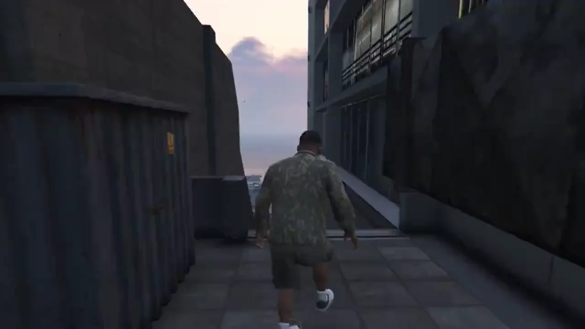

# SK8V

**Skate 3 gameplay. GTA V's open world.**


SK8V brings *Skate 3*'s Flick-It controls, board/skater physics, grinds, manuals, skitching, tricks, combos, bails, scoring, session markers, and Hall of Meat into **GTA V Legacy Story Mode**. Skate's gameplay runs alongside GTA's characters, traffic, weapons, radio, and world interactions. Skate 3’s own audio engine runs inside GTA’s mixer, so wheels sound different on every GTA surface. Things like concrete, asphalt, wood, metal, tile all sound different, and your wheels click over the cracks and seams in the pavement, with almost complete coverage.

## Requirements
- **Controller is Required**
- **SSD is recommended for installation**
- **Windows x64**, **GTA V Legacy 1.0.3889.0**, and **ScriptHookV v3889.0 / 1158.13** with its ASI loader. (https://www.dev-c.com/gtav/scripthookv/)
- **A controller:** Xbox, or PlayStation (DualShock 4 / DualSense, USB or Bluetooth). Keyboard skating is not supported. On a PlayStation pad, Share (or the touchpad) is Back and Options is Start.
- Your own Skate 3 Xbox 360 disc ISO or extracted disc folder (tested: title ID 454108E6, media ID 5C087C2C, no title update)
- About **7 GB free** on your GTA drive for setup; roughly **2 GB** remains afterward.

**Story Mode only.** GTA V Enhanced, GTA Online, and FiveM are not supported.

## Install

1. Download and extract the latest **SK8V release ZIP** from [Releases](../../releases/latest), **not** GitHub's Source code ZIP.
2. Close GTA V and run **`SK8V Setup.cmd`**. (If your GTA installation is in a protected folder (Program Files, etc.) setup will offer to restart as administrator.)
3. Select your Skate 3 disc, choose **Regular** or **Goofy** stance, and press **Install**. Setup detects your GTA V folder when possible.
4. Launch GTA V Legacy **Story Mode with BattlEye disabled**. Select the **skateboard** in GTA's weapon wheel, then press `Y` to mount it.

Setup prepares data from your copies of both games. It can download a local Python environment if needed, and rerunning it resumes interrupted preparation.

Command-line alternative (Python 3.11+, NumPy, Pillow):

```powershell
python tools/prepare.py --skate "<Skate 3.iso or folder>" --gta "<GTA V folder>" --stance Goofy --install --clean
```

(from the extracted release folder; omit --stance for Regular).

## Controls

**All regular skating controls are Skate 3's.** SK8V adds:

| Input | Action |
|---|---|
| GTA weapon wheel → **Skateboard** | Enter Skate mode |
| `Y` / hold `Y` | Mount or dismount / put the board away and return to GTA |
| Keyboard `/` or controller `Back + LB` | Open SK8V menu |
| `Back` / hold `Back` | Equip or holster a weapon / open weapon wheel when armed |
| `LB` / `RB` when armed | Aim / fire |
| Hold `LB` + D-pad left/right, gun holstered | Change radio station (Skate 3's layout) |
| D-pad | Emotes, one per direction (set them in the SK8V menu) |
| D-pad left/right, gun equipped | Change weapon |
| Double-tap `X` on foot near a grabbable wall | GTA mantle, then return to Skate |

### Keyboard and mouse

Without a controller, the keyboard and mouse play Skate. The keys are in `SkateVKeys.txt` beside the game (written with these defaults on first start; rebind any action there, `Keyboard=0` in `SkateVLegacy.ini` turns it off):

| Key | Skate |
|---|---|
| `W` `A` `S` `D` | Left stick (steer, walk) |
| `Shift` | Push (A) |
| `Space` | Pop: hold to crouch, let go to ollie |
| Arrow keys / numpad | Trick stick: type the motion (kickflip: down, then up-left) |
| `E` / hold `E` | Mount or dismount / put the board away (Y) |
| `F` | On foot (no vehicle within 3.5 m): board out and skate. Skating: back to GTA in one press (steps off first) |
| `B` (hold, behind a moving car) | Skitch: hold on to the car (Skate's RB) |
| `Tab` / mouse buttons | Gun out or away (hold `Tab`: GTA's weapon wheel); with a gun out the right mouse button aims and the left one shoots |
| `F10` or `/` | SK8V's menu (every setting; `/` is the US layout's key) |
| `,` / `.` | Radio: previous / next station |
| `N` / hold `J` | Set a session marker / back to it |
| `M` | GTA's interaction menu, also while skating |

Every key can be changed in SK8V's menu (F10), page Keyboard keys: Enter, then the new key. The page also switches the whole layout: GTAxSkate's standard (above) or Skate's controller positions (I J K L as the trick stick, Space push; no numpad needed). While you skate on the keyboard, your keys are listed down the left side of the screen (`KeyboardHints=0` or the menu's Controller and HUD page hides them).
| `Q` | Hippie jump |
| `T` / `Ctrl` | X / B |

Swimming switches to GTA automatically and returns to Skate afterward. While skating, GTA's GPS route to your waypoint stays on, and GTA's skate parks are on the map as yellow blips (`GpsWhileSkating=` / `SkateSpots=` in `SkateVLegacy.ini`). **M** opens GTA's interaction menu while skating too, and the menu's Interaction page sets the GPS to the nearest clothing store or skate spot. The SK8V menu's gameplay page also tunes Skate itself: pop height, grind pop, push, braking, steering, wobble, grip, turn power, manual drag, hold fakie and the hippie jump's height (1 = Skate 3; 1.6 clears a car). The character's GTA stamina skill sets push and pop (85 % with none), and skating at speed trains it like sprinting (`Stamina=`). In Binco, the Discount Store and Suburban, **G** opens Skate 3's board shop: complete boards and every deck, truck, wheel, griptape and paint on its own, paid with the character's cash. Michael, Franklin and Trevor each keep their own boards (`SkateVBoards-<name>.txt` in the game folder), and the bought board is the one you ride; it wears with riding, grinds, slides and bails until it shows Skate 3's worn finish, and a new one starts fresh (`BoardShop=` in `SkateVLegacy.ini`). **V** cycles the camera while skating: Skate 3's camera, GTA's near, middle and far follow camera (turned with the mouse), GTA's first person and the skater's eyes (the mouse looks round); Near, middle and far follow the board, so tricks never swing the camera into the skater; the mouse turns them. The view is kept between walking and skating (`CameraRemember=`); `CameraView=` is the standard one. In a GTA view, walking follows GTA's camera. On the keyboard **R** cycles the cinematic camera (shots that cut like GTA's cinematic camera in a car: chase, roadside, side, overhead, wheel, telephoto, front) and the skate filmer's low fisheye, then back. Both are framed and graded like a real camera: 2.39:1 bars, a film look and shallow focus for the cinematic camera, 4:3 and a handheld shake for the filmer (`CinemaFilter=`, `FilmerFilter=`). `SkateRadio=RADIO_19_USER` (or the menu) tunes the radio to Self Radio whenever skating starts, for example to Skate 3's soundtrack in your User Music. `PedsSurvive=1` ("Knocked peds survive" in the menu) makes people the board knocks down get up again instead of dying, gentler still with `PedLaunch=0`. **Hall of Meat is on by default** and can be disabled in the SK8V menu, alongside other gameplay settings.

### Unable to save settings in the menu?

1. Right-click your game install folder and select Properties.
2. Click the Security tab and click Edit.
3. Click Add, type your specific user account name (or less preferably, Everyone), then click Check Names and OK.
4. Select the newly added user or group, check the box for Full control under the Allow column, then click Apply and OK

### Known Limitations & Future Support

- **Rockstar Editor:** Recording and playback are not currently functional with SK8V. Support is planned for a future update.

- **Teleporting while skating:** Teleporting directly while Skate mode is active may cause the skater to fall through the map. Switch back to GTA control before teleporting, then resume skating at your destination.

- **GTA V Enhanced:** SK8V currently supports GTA V Legacy only. Enhanced Edition compatibility is a long-term goal, but may require significant additional work and is not guaranteed.

## Support Me
[](https://buymeacoffee.com/becaring) [](https://ko-fi.com/becaring)

If you had fun with SK8V, a donation is NEVER required but always appreciated <3 

## Uninstall

With GTA V closed, remove these from its folder:

- `SkateVLegacy.asi`, `SkateVRuntime.dll`, `SkateVLegacy.ini`, `SkateVLegacy.installed.json`
- `SK8V/`
- `update/x64/dlcpacks/skatev/`

Logs and records are in `%LOCALAPPDATA%\SkateV` and can be deleted separately. ScriptHookV is left untouched.

## Building from Source

Run BOOTSTRAP.bat to build the code, then follow BUILDING.md to package a release. The baked world collision data is copied from a published release.

## License

Original SK8V code is [Apache-2.0](LICENSE); third-party components keep their own licenses and are credited in [NOTICE](NOTICE). SK8V is an unofficial fan project, unaffiliated with EA, Rockstar Games, or Take-Two Interactive. No GTA V or Skate 3 retail assets, executables, keys, or proprietary SDK redistributables are included; supply your own game copies.
